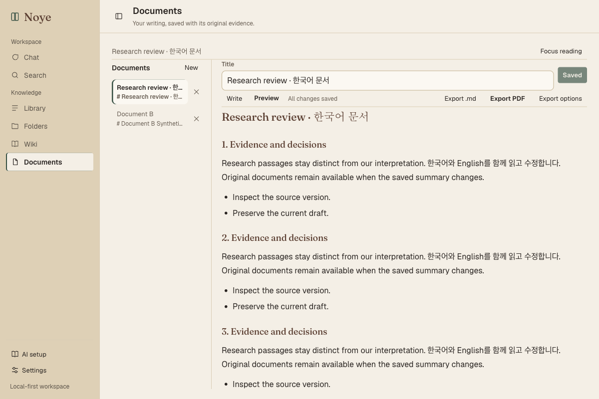
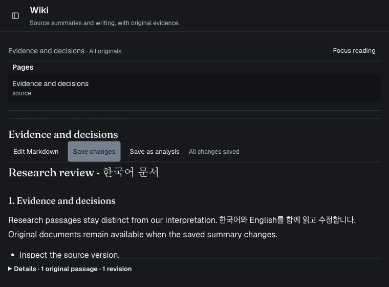

# Work-centered desktop design

The owner selected the work-centered design direction on 2026-10-12. This
branch starts from integrated main `3c02c4d` (PR #62) and implements the design
review across Chat, Search, Library, Folders, Wiki and Documents. It contributes
to Phase 8 usability; it does not close the full native/model/export acceptance
checklist.

## Delivered changes

| Review issue | Result |
| --- | --- |
| Meaningful low-emphasis text had 2.77:1 light contrast | `--ink-faint` now measures 4.62:1 on light canvas; navigation uses the existing text-safe inset token. |
| Serif styling applied to utility headings | Workspace titles and controls use sans-serif roles; display serif remains explicit in the wordmark and document presentation. |
| A 260px navigation column and 240px document list restricted writing | Shared 200px navigation and 200px secondary lists, a remembered 60px rail, and focus reading give content more space. |
| Documents and Wiki placed lists on opposite sides | Both use a left secondary list and the same workspace header/editor arrangement. |
| Save/export appeared below long document content | Title, save state, revision selection and exports precede the scrolling body. |
| Healthy service controls occupied a permanent top strip | Healthy services have no strip; AI setup and Settings remain in navigation and native menus. Missing-service notices remain visible. |
| Populated Library repeated the large empty upload area | Populated intake uses compact Add files, with the same global drop handler and upload/rejection feedback. Empty intake keeps the larger accessible picker. |
| File cards and evidence used many nested borders and small labels | File and evidence rows use quiet dividers, readable metadata and optional Details. Original location/availability, failures and recovery actions remain discoverable. |
| Folders/Library and Wiki/brand shared icons | Section icons are distinct, from the existing inline SVG family. |

The interface retains the owner's warm forest/brass light palette and charcoal,
off-white, muted-blue dark palette. No UI library, font dependency or backend
schema was added.

Native Settings opens with Command-comma and from the application menu; AI Setup
also has an application-menu entry. View → Toggle Sidebar uses
Command-Shift-L. Standard Edit/Window menus are preserved. The original-opening
command accepts only the owned sidecar's loopback origin, a source UUID and an
optional positive page fragment; no general JavaScript shell capability was
added.

## State and evidence constraints

Layout changes hide existing elements rather than reparenting/remounting editors.
They do not reset conversation drafts/pending requests, document draft ownership
and expected revisions, Wiki scope/history, or search request generations.
Optional metadata remains mounted inside native Details disclosures.

File/page/current-original availability precede saved excerpts. Hashes and
processing details use secondary disclosures. A matching source version does not
verify the answer's claims; legacy and unavailable originals retain explicit
labels. Original-link failures have a retryable error message.

## Automated and build validation

Commands ran from their appropriate project directories:

| Check | Observed result |
| --- | --- |
| `npm test` | 48 files, 357 tests passed after the small-window metadata fix. |
| `npm run lint` | Passed. |
| `npx tsc --noEmit --incremental false` | Passed. |
| `npm run build` | Passed in normal web mode; eight routes prerendered. |
| `cargo fmt`, `cargo test --locked`, `cargo clippy --locked -- -D warnings` | Passed; seven Rust tests, including native source URL rejection cases. |
| `npm run desktop:build -- --no-sign --config /private/tmp/noye-design-qa-config.json -- --locked` | Passed, including frozen backend and desktop static export; unsigned Apple Silicon QA bundle, 68.08 MiB. Subsequent layout rebuilds reused the unchanged validated sidecar and ran `npm run desktop:ui` before bundling. |
| `NOYE_TEST_SIDECAR=… .venv/bin/pytest app/tests/test_desktop.py -q -p no:cacheprovider` | 10 passed, seven dependency warnings, 23.74s against the frozen sidecar. |
| `git diff --check` | Passed. |

Regression checks include pending saves through repeated focus toggles, preserved
historical selection and material scope, later typing after a save acknowledgement,
metadata toggles retaining the same textarea/draft owner/base, collapse persistence
and storage failure, mobile navigation focus/Escape, native menu listener cleanup,
original-link failure/retry, and Keep returning focus after removal/rebuild
confirmation. Layout flags do not dispatch new model or save requests.

## Rendered observations

Chromium served the desktop static export with controlled backend/native fixtures.
These observations establish layout and interactions, not live model speed or
answer quality. Cache-bypassing reloads were required after replacing the served
static bundle; measurements from cached styles were not accepted as final.

At 1200×800, the document editor measures 732px wide versus the review's 604px.
Its 200px list is on the left. Markdown and PDF controls are at y=181–213,
versus the previous below-fold export area near y=821. The final preview shows
long Korean/English text and the top actions together:

At 760×560, Chat retained a 314.5px conversation scroller, with the composer
inside the viewport. The open AI panel measured 360×140 at x=388, y=102 and
stayed within the window; it did not resize the conversation. Chat, Library and
Folders were also observed without horizontal overflow or alerts at 1200×800.

The first small-window Wiki pass exposed overlapping content: four closed
metadata rows consumed the footer while a fixed 180px body minimum overflowed
a 92.2px editor. The final one-row Details grouping, shrinkable reading body
and 112px stacked list produce a 256.2px editor with a 187.2px reading body.
The closed footer is 40.5px and begins exactly after the reading body, with no
overlap or horizontal overflow:

Calculated text contrast is 4.62:1/5.00:1 for low-emphasis light copy on
canvas/card, 6.51:1/5.68:1 in dark mode, and 4.97:1/9.44:1 for inset navigation
copy. These token calculations do not certify every rendered state.

## Native QA observations and limits

The QA identifier and workspace were separate from the personal app. No model,
daemon, real credential or paid cloud operation was performed.

Native Command-comma and the application's Settings menu opened the dialog.
Missing Ollama/Qdrant notices remained visible. A controlled 4,340-character
Korean/English document opened with its save and export controls above the body.
An unsaved Korean marker survived focus reading, its exit, navigation collapse
and Preview. The resulting Markdown file contained all 20 sections and matched
the current unsaved editor exactly: 4,947 UTF-8 bytes. Saving from the native UI
then produced the same 4,369-character body in the owned backend. Closing the
QA window stopped its owned backend.

Native PDF reached the system's four-page print preview. The Save as PDF panel
kept Save disabled, and Open in Preview did not yield an observable Preview
session. No PDF file from this pass was inspected; the cause is not established.
The actual OS-browser destination after original-link activation was not
confirmed with the available browser inventory. Native command validation and
fixture dispatch do not substitute for that confirmation.

Some browser requests were stopped by automatic approval-review usage/rate
failures. Work resumed when the review service was available. Native automation
also had a delayed initial connection and intermittent window-target errors;
raising/rebinding the QA window recovered Markdown interactions. These tool
failures were kept separate from application failures.

Full light/dark coverage at every viewport, physical IME behavior, screen-reader
acceptance, signed/notarized distribution, other operating systems, live
source-driven model quality, cloud credentials and the complete Phase 8 workflow
remain unaccepted. No approved screenshot baseline exists; formal visual
regression is inconclusive.

## Review

Separate read-only passes reviewed shared interactions/Chat/Search,
Library/Folders, and Documents/Wiki. They found no new P0/P1 state regression.
They prompted fixes for mobile navigation focus/Escape, bounded Chat popovers,
primary-button label contrast, partial-result color, long upload filenames and
narrow file-name rows. Two independent mobile focus checks passed. The final
small-window footer defect was found in browser measurement and corrected with
additional draft-preservation tests.

Automatic draft rebasing, resetting editors for focus mode, general native URL
opening and new export/generation APIs were not introduced. Existing ownership,
scope and expected-revision checks remain the authority for writing.
